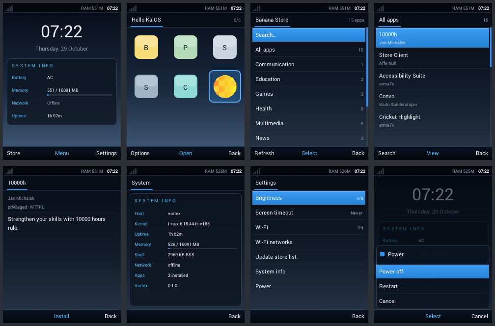

# Vortex

Vortex is a Void Linux based distribution for KaiOS-class feature phones. The
Nokia 6300 4G (`nokia-leo`, Snapdragon 210 / MSM8909, 512 MB RAM, 240×320
screen, T9 keypad) is the primary target.

* **Shell in Nuklear** (home, launcher, Banana Store, dialer, calculator, settings), with a "steel night" look: a navy-to-steel
  wallpaper under translucent dark panels, azure selection bars and cyan
  SYSTEM INFO-style labels. The home screen, launcher, app store, dialer and
  settings are one small C program, `vortex-shell`. It uses
  [Nuklear](https://github.com/Immediate-Mode-UI/Nuklear) and its own software
  rasteriser that draws to `/dev/fb0`.
* **Tight memory budget.** The target for idle userspace is 10–15 MB. The
  shell itself uses about 1 MB of private memory.
* **Runs KaiOS apps.** Packaged KaiOS 2.5 apps run in WPE WebKit through a
  compatibility shim. The shim maps the soft keys, Backspace-to-exit,
  `navigator.mozApps`, `mozSettings`, `MozActivity` and KaiAds.
* **Includes the Banana Store.** The shell has a native client for the
  [BananaHackers store](https://store.bananahackers.net). You can browse,
  search, install, update and remove apps from the phone.



*These are real frames from the headless test build, at 240×320.*

## Status

| Part | State |
|---|---|
| Shell (UI, launcher, store client, T9 input, settings, power menu) | Working. Tested headless on the host, clean under ASan/UBSan. |
| KaiOS installer (OmniSD and plain zips) and JS shim | Working. Tested on the host; the shim is checked in Chromium. |
| Phone image (`rootfs/build.sh`, `rootfs/mkimage.sh`) | Builds flashable files: lk2nd + boot image, a rootfs for `userdata` or a microSD card. **Not booted on a 6300 4G yet.** |
| Web engine on the phone | WebKitGTK in Cage, the stack tested in the VM. WPE/Cog templates in `packaging/` are for later. |
| x86_64 VM build (QEMU) | Boots. Store → install → run → close tested end to end with BankiTube. |
| Calls and SMS | Experimental: a dialer UI plus an oFono helper. No incoming calls, no call audio routing. |

Nothing here has booted on a real 6300 4G yet. The known open problems are
listed in [docs/device-nokia-6300-4g.md](docs/device-nokia-6300-4g.md). Most
important is getting the web engine to render on this phone's display.

## Try the shell on a PC

```sh
make headless                  # builds shell/vortex-shell-headless
make test                      # screenshot tests + runtime/shim tests
```

`shell/tests/out/*.png` holds the screenshots. You can drive the shell
yourself with a key script:

```sh
cd shell && ./vortex-shell-headless -c tests/out/vortex.conf \
    --script "ok right shot:/tmp/launcher.ppm soft_right shot:/tmp/home.ppm"
```

On a Linux virtual terminal, the device build (`make shell`) runs on the real
framebuffer: `sudo ./shell/vortex-shell -s 240x320 -c <config>`. The arrow
keys, Enter, F1/F2 (soft keys), Esc (back) and F4 (end) all work.

## Build the phone image

```sh
sudo rootfs/build.sh       # Void armv7 rootfs + postmarketOS kernel -> out/phone/
sudo rootfs/mkimage.sh     # flashable files -> out/phone/vortex-nokia-6300-4g/
```

No ARM machine, emulator or kernel compile is needed. Void's armv7
packages are unpacked on the PC and configured on the phone's first boot.
The kernel and lk2nd are postmarketOS' prebuilt packages for MSM8909, and the
shell is cross-compiled with clang. How to install the result (EDL, or a
microSD card) is in [docs/flashing.md](docs/flashing.md).

## Layout

```
shell/       vortex-shell (C99 + Nuklear); src/, tests/, third_party/
runtime/     KaiOS app support: installer, launcher, JS shim, wifi/call/power helpers
rootfs/      Void rootfs builder, package list, overlay (runit services, configs)
kernel/      kernel build script + config fragment
packaging/   xbps-src templates: wpewebkit, cog (+ patch), vortex
tools/       memreport.sh (PSS-based RAM report)
docs/        architecture, memory budget, device notes, KaiOS app compatibility
```

## Documentation

* [Architecture](docs/architecture.md): how the shell, runtime and system fit together
* [Memory budget](docs/memory.md): where the 10–15 MB goes, and how it is measured
* [KaiOS apps](docs/kaios-apps.md): which apps work and what the shim provides
* [Nokia 6300 4G](docs/device-nokia-6300-4g.md): bring-up, flashing and open problems
* [VM](docs/vm.md): run Vortex in QEMU, and the end-to-end store/app test (BankiTube results)

## Third-party code

* Nuklear: MIT / public domain (`shell/third_party/nuklear`)
* stb_image: MIT / public domain (`shell/third_party/stb`)
* Roboto font: Apache-2.0 (`assets/fonts`)
* The panel init sequence and kernel config are downloaded from postmarketOS
  at build time. They are not vendored.
