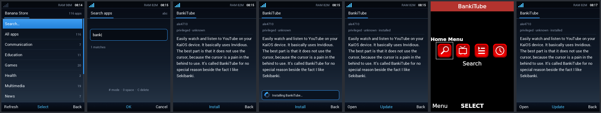

# Vortex in a VM

`tools/vm/` builds and boots an x86_64 Vortex that behaves like the phone:
same shell, store, KaiOS runtime, configs and runit services, on a 240×320
framebuffer.

```sh
sudo tools/vm/build.sh          # Void x86_64-musl rootfs + out/vm/vortex-vm.img
tools/vm/run.sh                 # boot in a QEMU window (KVM if available)
```

Keys: arrows, Enter = OK, F1/F2 = soft keys, Esc = back, F3 = call,
F4 = end (hold it for the power menu), and the digits are the keypad. The
serial port gives a root shell.

How the VM differs from the phone:

| | Phone | VM |
|---|---|---|
| CPU / libc | armv7l-musl | x86_64-musl |
| Web engine | WPE WebKit + Cog (DRM) | WebKitGTK 2.50 in the Cage kiosk compositor (`runtime/vortex-webview-cage`), because Void doesn't ship WPE |
| Display | panel-mipi-dbi, 240×320 | bochs-display, 240×320 |

`vortex-webview` accepts the same options `vortex-kai-run` passes to Cog:
`--dir-handler=app:DIR`, `--disable-web-security`, `--user-agent`, and quit
on `window.close()`. It also gives each app its own storage. So the
installer, launcher, shim and shell code paths are the same as on the phone.

## Automated test: install and run a store app

```sh
tools/vm/e2e-store-app.sh "2 2 wait:1500 2 wait:1500 6 6 wait:1500 5 5"   # T9 for "bank"
```

The script boots the VM headless and opens the Banana Store. It searches
with T9, installs the first hit and opens it, then closes it with End and
checks the kernel log for crashes. Screenshots land in `out/vm/e2e/`.
`tools/vm/ctl.py` drives the VM: screenshots and keys go through the QEMU
monitor, and commands go through the serial shell.

Behind a proxy, build with `VORTEX_VM_PROXY=http://10.0.2.2:PORT` (and
`VORTEX_VM_CA=` for TLS-inspecting proxies).

## Result: BankiTube (YouTube via Invidious)



Tested 2026-10-29 under software emulation (TCG, no KVM):

| Step | Result |
|---|---|
| Boot to shell | Works, about 60 s under TCG. The whole VM uses about 100 MB at idle. |
| Banana Store download (116 apps), T9 search "bank" | Works |
| Install (`vortex-kai-install`, OmniSD package) | Works |
| Launch: shim injected, `app://bankitube/`, 240×320, soft-key labels | Works. First paint takes about 60–90 s under TCG. |
| Keys: navigation, typing a search | Works |
| End closes the app, shell repaints, memory released | Works |
| **YouTube search / playback** | **Fails: "Couldn't get results."** BankiTube's built-in Invidious servers are offline. The live server list (`api.invidious.io`) has one API-enabled server, and it returns 403. `yewtu.be` answers only with an anti-bot page. No public Invidious API works without a captcha right now, so the app fails the same way on a real KaiOS phone. |

Bugs this test found and fixed in Vortex:

* **Shell crash** after closing an app that was opened from its store page.
  The store records had been freed to make room for the app, and the page
  was redrawn from them. The shell now reloads them from cache, and
  `tests/run.sh` has a regression test for it (`store-open`).
* **Store stuck on "unavailable"** when opened before the network was up.
  It now retries every 5 s while the store screen is showing
  (`store-retry` test).
* The network indicator only looked at Wi-Fi. It now counts any link.
* `oom_score_adj` writes failed with `echo`; they now use `printf`.
* VM adapter: removed the window title bar and hid the mouse pointer.

Memory while BankiTube runs in the VM: WebKitWebProcess is about 300 MB RSS,
plus the network process (about 70 MB), plus the Python/GTK UI process
(about 220 MB, which includes llvmpipe). The phone uses Cog/WPE instead,
which has no GTK or Python layer. Expect much less there, but it still
needs measuring on hardware.
